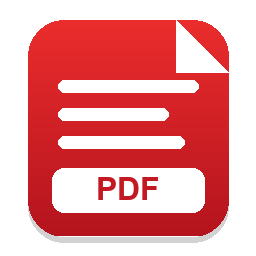

# Light PDF Viewer

**v1.0.2** &nbsp;•&nbsp; **Windows 10 / 11 (x64)** &nbsp;•&nbsp; **Ultra-Light Native Viewer**

*A fast, ultra-lightweight PDF viewer for Windows — built for clean reading with zero bloat, zero background processes, and zero tracking.*

[Download v1.0.2 (`LightPDF_Setup.exe`)](https://github.com/anivimorthala/LightPDF/releases/latest)

---

## Introduction

**Light PDF Viewer** delivers an Adobe-grade PDF reading experience in a tiny native Windows application. Unlike heavy PDF suites, it never runs on Windows startup, never hooks into browser downloads, and leaves zero background services running when closed.

---

## What It Can Do

| Feature | Details |
| :--- | :--- |
| **Multi-Tab Reading** | Open multiple PDFs in one window (`Ctrl+T` new tab, `Ctrl+W` or middle-click to close). |
| **Open on Click** | Double-clicking any `.pdf` in File Explorer opens it directly (or adds a new tab if already open). |
| **Rich PDF Controls** | Crisp vector text, text selection & copy, `Ctrl+F` search, zoom, Fit to Width/Page, bookmarks, print (`Ctrl+P`), and rotate. |
| **Distraction-Free Mode** | Press `F11` to hide the top bar for full-screen reading (`Esc` to exit). |
| **Zero Background Footprint** | Disabled on Windows boot, never auto-opens Chrome/Edge downloads, and exits completely on close. |
| **Zero Tracking** | No telemetry, no saved history, and temporary session cache is deleted automatically on exit. |
| **1-Click Installer & Uninstall** | `LightPDF_Setup.exe` checks `.NET Framework 4.x` & `WebView2`, installs cleanly, and supports **Control Panel / Installed Apps** uninstall. |
| **Manual Updates (`v1.0.2`)** | Click **`v1.0.2 • Updates`** in the top bar anytime to check GitHub Releases for new versions and release notes. |

---

## Installation (`v1.0.2`)

1. Download **`LightPDF_Setup.exe`** from the [Releases](https://github.com/anivimorthala/LightPDF/releases) page (or directly from this repository).
2. Double-click **`LightPDF_Setup.exe`** and click **Install** *(if Edge WebView2 is missing on an older Windows 10 PC, the setup offers a 1-click official Microsoft download with live progress)*.
3. Click **Finish** — Windows Default Apps will open so you can set **Light PDF Viewer** as your default `.pdf` app.

---

## Keyboard Shortcuts

| Shortcut | Action |
| :--- | :--- |
| `Ctrl + O` | Open PDF file(s) |
| `Ctrl + T` | Open new tab |
| `Ctrl + W` | Close current tab |
| `Ctrl + F` | Find text in PDF |
| `Ctrl + P` | Print PDF |
| `Ctrl + +` / `Ctrl + -` | Zoom in / out |
| `F11` / `Esc` | Toggle Fullscreen |

---

## Release Checksums (`v1.0.2`)

| File | SHA-256 |
| :--- | :--- |
| `LightPDF_Setup.exe` | `58887E436C49FEDC9EFE0F3FE668DEFCE4374BEDE24E7948287164178EFC8A56` |
| `LightPDF.exe` | `39EBFF18590EB96BAC28EB34034308C1D21B5E2265A6816B75EFD3CB6E00EF1B` |
